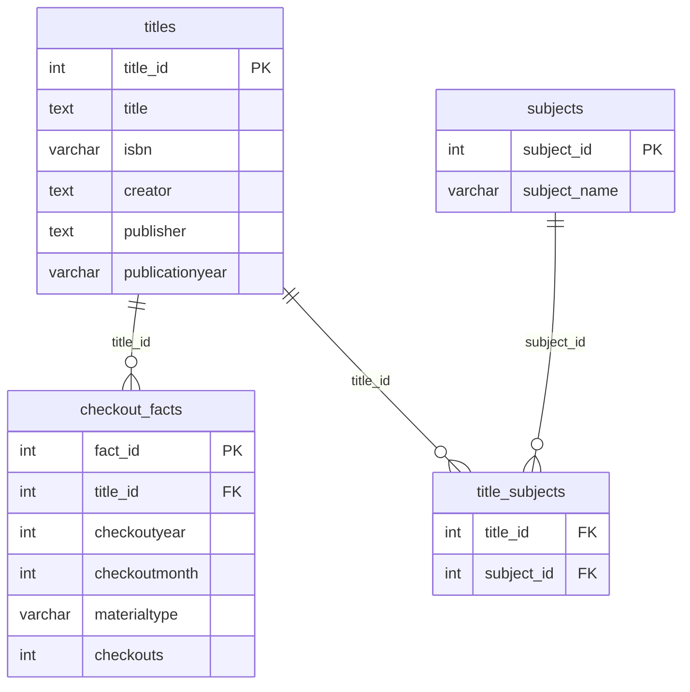

# Занятие 15. Итоговая работа

Срез: 2021 H2 (месяцы 7–12), вариант V=2 (`SOUNDDISC`). Стек: Go, Gin, pgx, PostgreSQL 16.

## 1. Схема БД (ER)

## 2. Три функции (проект `14-api-integration`)

| Роль | Эндпоинт | Реализация |
|---|---|---|
| Хранение | `POST /checkouts` | `internal/adapter/postgres/checkout.go`, `INSERT INTO checkout_facts`, FK-ошибка 23503 → 404 |
| Поиск | `GET /search?q=` | `to_tsvector('english', title) @@ phraseto_tsquery('english', $1)`, параметр `$1` |
| Изменение | `PUT /checkouts` | `UPDATE checkout_facts SET checkouts = $2 WHERE fact_id = $1` |

Приложение: Gin, архитектура портов и адаптеров, ключ `X-API-Key`, проверка в Postman (11 запросов, 17 проверок).

## 3. Индекс с доказательством (занятие 9)

Таблица `big_checkouts`, 1 000 000 строк.

| Запрос | Без индекса | С индексом |
|---|---|---|
| `title = 'Find Me (unabridged)'` | 51 мс, Seq Scan | 1.9 мс, Bitmap Heap Scan (B-tree) |
| `checkoutyear = 2019 AND materialtype = 'SOUNDDISC'` | 138 мс, Parallel Seq Scan | 39 мс, Bitmap Heap Scan (composite) |

Планы: `../09-indexes/plans/`, воспроизведение `../09-indexes/run.sh`.

## 4. Роли и права

`sql/01_roles.sql`, проверка `./run_checks.sh`, таблица `sql/02_checks.md`.

| Операция | app_reader | app_writer |
|---|---|---|
| SELECT | да | да |
| INSERT / UPDATE | `permission denied` | да (`checkout_facts`, `titles`) |
| DELETE | `permission denied` | `permission denied` |
| DROP TABLE | `must be owner of table` | `must be owner of table` |
| CREATE TABLE | `permission denied for schema public` | `permission denied for schema public` |

## 5. SQL-инъекция

Вывод запуска: `output/injection.txt`. Все запросы шли под `app_reader`.

| Ввод | Уязвимая версия | Параметризованная |
|---|---|---|
| `Love Story` | 4 строки | 4 строки |
| `zzzz%' OR 1=1 --` | 5000 строк (все) | 0 |
| `zzzz%' UNION SELECT oid::text, rolname FROM pg_roles --` | 17 ролей сервера | 0 |
| `x%'; DROP TABLE subjects; --` | `must be owner of table subjects` | 0 |

Права ограничили ущерб: `DROP` не прошёл. Но `UNION` прочитал `pg_roles`, а `OR 1=1` вернул все строки, потому что `SELECT` у роли есть. От чтения защищает только параметризация: значение уходит как данные и не становится частью SQL.

## 6. Бэкап

`backup/backup.sh`, лог `backup/restore.log`, дамп `backup/seattle_library.dump` (формат custom, 4 таблицы).
Аварию (`DROP TABLE`) устроил в копии БД `seattle_victim`, чтобы не ломать рабочую. Восстановил в новую БД `seattle_restore`.

| Таблица | До | После восстановления |
|---|---|---|
| titles | 5000 | 5000 |
| checkout_facts | 5000 | 5000 |
| subjects | 6536 | 6536 |
| title_subjects | 18961 | 18961 |

Числа совпали.

## 7. Ответы на вопросы

**Почему параметризованный запрос защищает от инъекции, а ограничение прав нет?**
При параметризации текст запроса и значения идут отдельно: сервер сначала разбирает SQL с `$1`, затем подставляет значение как данные, и оно не может изменить структуру запроса. Права лишь задают, что разрешено делать пользователю БД. У `app_reader` есть `SELECT`, поэтому инъекция читает всё, что он видит.

**Чем бэкап отличается от репликации?**
Репликация копирует изменения сразу, в том числе ошибочные: `DROP TABLE` пройдёт и на реплике. Бэкап фиксирует состояние на момент времени, из него можно вернуться к состоянию до аварии. Реплика защищает от отказа сервера, бэкап от ошибки человека.
